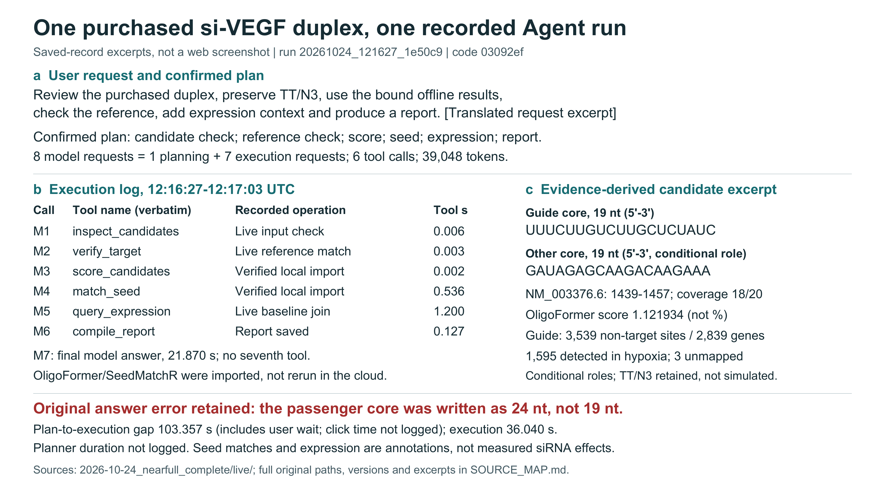
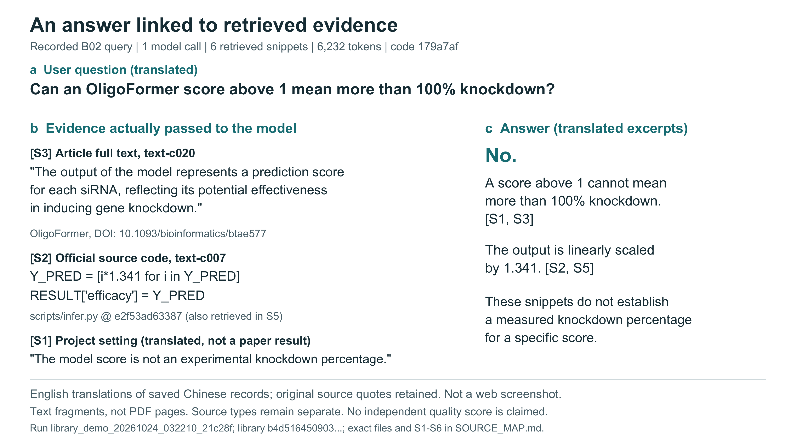

# PPT用两张真实证据图

接手最新main：`927910c74181417b2d3229e4e8a3ffeedec841bd`，执行10月25日10:40复核的素材A、B。这一批只整理已有记录，没有新模型问答、候选预测、seed扫描、近全长扫描或网站更新。

## 直接使用

两图均为16:9，英文，真实Arial/Arial Bold，PNG为3840×2160像素；SVG文字可编辑，PDF嵌入字体。它们明确标注“原记录摘录排版”，**不是新网页截图**。中文问答译文已标出，没有伪造英文原始会话。

| 图 | 预览与下载 | 简单中文讲解句 |
|---|---|---|
| A：既购si-VEGF真实执行案例 | [PNG](figures/A_purchased_Agent_case.png) · [可编辑SVG](figures/A_purchased_Agent_case.svg) · [PDF](figures/A_purchased_Agent_case.pdf) | 这条既购序列在原网站完成了六步核查；分数和种子匹配来自已计算结果的导入，原回答另有一处把19位序列写成24位的错误，不能说全部回答正确。 |
| B：文献问答与实际原文证据 | [PNG](figures/B_literature_answer_evidence.png) · [可编辑SVG](figures/B_literature_answer_evidence.svg) · [PDF](figures/B_literature_answer_evidence.pdf) | 这一次中文问答确实取用了英文论文和官方源码，并引用它们解释“模型分数不等于实测敲低率”；这一个例子不代表系统的总体准确率。 |

正式英文图注：[CAPTIONS_EN.md](CAPTIONS_EN.md)。逐项来源与译文对照：[SOURCE_MAP.md](SOURCE_MAP.md)。执行复核及剩余缺项：[REVIEW_RESPONSE.md](REVIEW_RESPONSE.md)。已实际检查的源文件指纹：[source_manifest.json](source_manifest.json)。原记录按原字节复制在raw_evidence/，没有替换历史目录文件。

## 放进现有PPT

优先放A、B，随后用已有完整65条预测图和264项近全长结果图。可拆分原图面板放大；九条只是历史子集，不能说是本次65条筛选终点。近全长图a的10、7、10、9可能指向重叠候选，不能相加成独立候选数；65条中23条有非靶0/1错配匹配，另外42条不能称安全。来源和选择说明见原10:40复核及配套JSON。

表达背景若要展示，使用真实Arial综合图的a面板，或以后按同一8点单独重排；不是siRNA干预结果，也不是4轮独立培养。不使用旧DejaVu Sans单图冒称Arial。

现有三组开发记录没有独立科学评分，只可展示评价方法和空白表，不能画准确率或优越性图。第7天真实问答的原始记录在`research/2026-10-24_followup/live/`，可以做另页备份；本批没有为它新增图或模型请求。旧B08是程序范围停止、0模型调用，不能当模型拒答实验证据。

## 可复现与上传

运行`python scripts/build_ppt_evidence_figures_20261025.py`只读原件并导出两图，使用ReportLab和Poppler。执行环境、源文件逐字核对、实际时间段、字体和视觉检查见[VALIDATION.md](VALIDATION.md)及JSON文件。源码/结果上传、当前网站部署和新模型调用是三件不同的事；本批不部署，也不把此前尚未部署的序列防错回放称成线上新截图。

最终GitHub、Drive位置及核对范围见SYNC.json。两图已具备可复核的实际内容，可交科研对话决定PPT取舍；独立评分和实测效力仍未完成，不能靠排版补出来。
