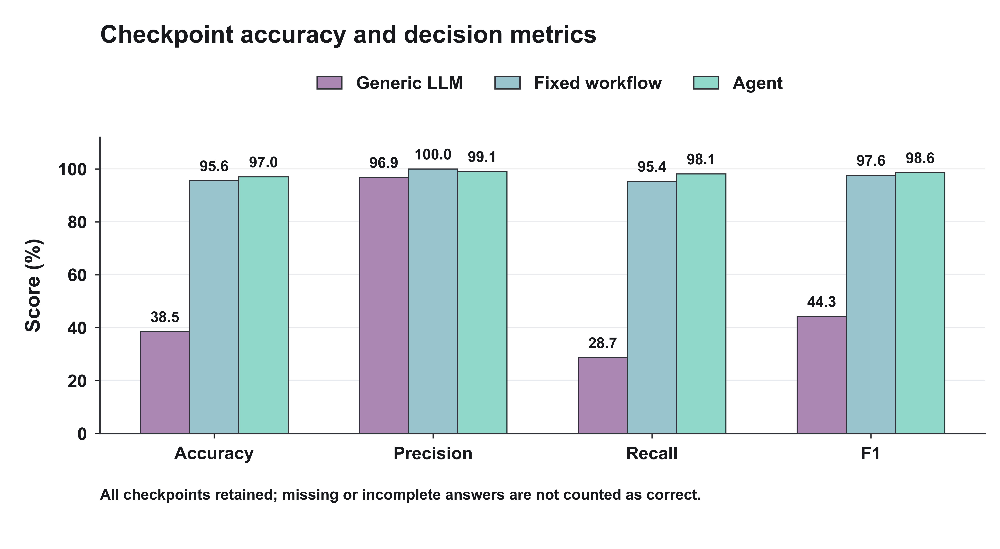
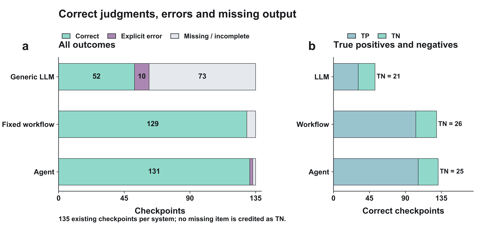
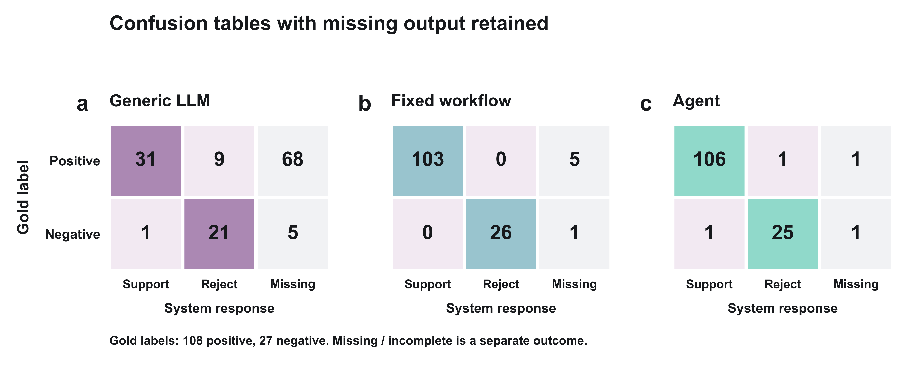

# 准确率、精确率、召回率与 F1：135 项核查的回顾性重编码

本目录补上用户要求的 **Accuracy（准确率）**，并使用同一套判断规则重算另外三个指标。
结果来自已有 27 份原答、实际交付附件和已完成的 AI 辅助核查（含用户转达的 BCC 裁决）。
没有新增专家评分、重跑系统或修改原始答复。旧任务通过率不参与本次准确率计算。

三组使用完全相同的 **135 项原核查标准：108 项正例、27 项负例**。
负例是原表已有的边界或禁止事项，如旧分数不可用于新序列、模型分数不是实测敲低率、
供应商链角色未确认、缺少表达表时不得替代数据。没有额外添加负例来增加 TN。
这是一套事后明确极性的核查分析，不是预注册、独立盲评或未见测试集结果。

## 总体结果（micro：合并每组 135 项）

| 系统 | 准确率 | 精确率 | 召回率 | F1 | 明确完成判断的比例 |
|---|---:|---:|---:|---:|---:|
| 通用 LLM | 38.52% | 96.88% | 28.70% | 44.29% | 45.93% |
| 固定工作流 | 95.56% | 100.00% | 95.37% | 97.63% | 95.56% |
| Agent | 97.04% | 99.07% | 98.15% | 98.60% | 98.52% |

**准确率 = 正确的正例判断与负例判断之和 / 全部 135 项。缺答或不完整项计为未答对。**
精确率、召回率和 F1 对应正类；正例缺答计入正类漏判，负例缺答降低总体准确率，不能充当 TN。

| 系统 | TP | TN | FP | 显式 FN | 正例缺答/不完整 | 负例缺答/不完整 | 合计 |
|---|---:|---:|---:|---:|---:|---:|---:|
| 通用 LLM | 31 | 21 | 1 | 9 | 68 | 5 | 135 |
| 固定工作流 | 103 | 26 | 0 | 0 | 5 | 1 | 135 |
| Agent | 106 | 25 | 1 | 1 | 1 | 1 | 135 |

所有缺答均保留为 ABSTAIN，所以实际发布的是 **2×3 表：标准正/负 × 支持/否定/缺答**。
没有为了凑齐 2×2 表而把缺答强制变成否定。总体准确率仍按全体项目计算，并已用
scikit-learn 对三个预测标签（1、0、ABSTAIN）独立复算核对。

例如 Agent：准确率 = (106 + 25) / 135 = **97.04%**。
正类 FN = 1 个显式错误否定 + 1 个正例缺答；精确率 = 106/107，召回率 = 106/108。

## 图



主图：合并 135 项的四指标。[PNG](figures/Fig1_accuracy_precision_recall_f1_micro.png) · [SVG](figures/Fig1_accuracy_precision_recall_f1_micro.svg)



正确/错误/缺答及 TN 分解。[PNG](figures/Fig2_outcomes_and_true_negatives.png) · [SVG](figures/Fig2_outcomes_and_true_negatives.svg)



保留缺答的混淆表。[PNG](figures/Fig3_confusion_tables_with_abstentions.png) · [SVG](figures/Fig3_confusion_tables_with_abstentions.svg)

补充图：先逐任务计算，再对 9 个任务取平均。[PNG](figures/FigS1_accuracy_precision_recall_f1_macro.png) · [SVG](figures/FigS1_accuracy_precision_recall_f1_macro.svg)

全部使用真实 **Arial Bold**、参考 CRISPR-GPT 的柔和紫/蓝/绿配色、600 dpi PNG 和可编辑文字 SVG。
没有新生成 PDF。

## 复核入口

- [完整方法、公式、缺答处理和适用边界](PROTOCOL.md)
- [135 项命题、正负极性、原要求与参考证据](data/checkpoint_definitions.csv)
- [405 项判断与原证据位置](data/judgments.csv)
- [全部 81 项负例判断证据；其中 72 项 TN](data/negative_evidence_review.csv)
- [总体指标](data/metrics_micro.csv)、[任务平均指标](data/metrics_macro.csv)、[逐任务指标](data/metrics_by_task.csv)
- [2×3 混淆计数](data/confusion_matrix_2x3.csv)、[原始来源指纹](source_manifest.json)、[计算核验](verification.json)
- [保留的其他错误与范围说明](data/retained_extra_errors_and_scope_notes.json)、[英文图注](FIGURE_LEGENDS_EN.md)

本次正/负类定义与旧“内容抽取式 P/R/F1”不同，因此旧、新精确率等不能直接比较，
更不能解释为系统运行后变好了。这里的准确率数值等于原正确项数/135，是保留既有判断的结果。
任务 PASS（0/9、8/9、9/9）仍属于另一指标。四维专家评分表也仍是另一评价来源。

没有新增需要专家补判的模糊标签。原有不完整项按缺答处理，专家不能替系统补写答案。
本次极性重编码由 AI 完成，没有冒称得到专家对所有新命题的逐项批准。

## 复现

在本目录运行：

```bash
python compute_and_verify.py
python build_figures.py --font /path/to/Arial-Bold.ttf
```

如需从仓库旧原件重新生成判断表，使用包含 `source_manifest.json` 所列文件的仓库检出目录：

```bash
python recode_from_source.py --repo-root /path/to/siRNA-GPT
```

依赖：Python、numpy、scikit-learn、matplotlib、Pillow、fonttools。
字体必须是实际 Arial Bold 文件，缺少时脚本停止，不静默替换。字体文件不随代码分发。
