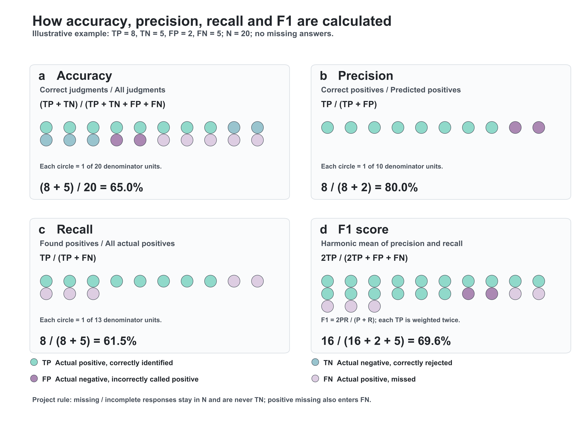

# Four-metric calculation schematic

Illustrative example only, **not project performance data**: TP=8, TN=5, FP=2,
FN=5, N=20, no abstentions. Accuracy=65.0%, precision=80.0%, recall=61.5%,
F1=69.6%. F1 circle counts use 2TP+FP+FN=23 weighted units; these are not 23 cases.

For the actual project data, missing/incomplete responses remain in the total
accuracy denominator and are never TN; positive abstentions also enter FN.
See [the full protocol](../PROTOCOL.md) for the 2x3 confusion table and formulas.

Verified Arial Bold; paper-derived colors; 600 dpi PNG and editable SVG.
Reproduce: `python draw_metric_schematic.py --font /path/to/Arial-Bold.ttf`.
