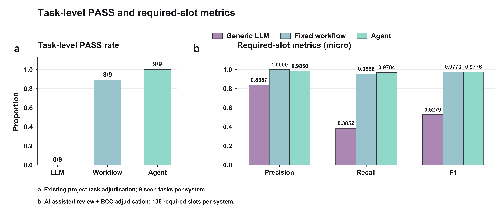

# 指标图新版：CRISPR-GPT参考配色、Arial Bold

本轮按用户2026-10-29要求重做当前四张指标图。使用CRISPR-GPT原文Figure 3b的柔和紫、浅蓝、薄荷绿；全部图内文字使用真实Arial Bold，按画布调整字号。原图与原始标签不覆盖。

## 直接查看



| 图 | 内容 | PNG | 可编辑SVG |
|---|---|---|---|
| Fig1 | 9题逐题等权平均的macro精确率、召回率、F1 | [PNG](figures/Fig1_macro_precision_recall_f1_BCC.png) | [SVG](figures/Fig1_macro_precision_recall_f1_BCC.svg) |
| Fig2 | 每组9题的整题通过率 | [PNG](figures/Fig2_task_pass_rate_reconciled.png) | [SVG](figures/Fig2_task_pass_rate_reconciled.svg) |
| Fig3 | 整题通过率与本轮micro逐项指标分面展示 | [PNG](figures/Fig3_task_and_slot_metrics_separate_panels.png) | [SVG](figures/Fig3_task_and_slot_metrics_separate_panels.svg) |
| FigS1 | 每组135项合并计算的micro精确率、召回率、F1 | [PNG](figures/FigS1_micro_precision_recall_f1_BCC.png) | [SVG](figures/FigS1_micro_precision_recall_f1_BCC.svg) |

全部PNG为600 dpi，SVG保留可编辑Arial Bold文本；按用户要求不新增PDF。图注单独放在[FIGURE_LEGENDS_EN.md](FIGURE_LEGENDS_EN.md)，避免挤在图内。

## 当前数值与来源

| 系统 | Task-level PASS rate | micro Precision | micro Recall | micro F1 |
|---|---:|---:|---:|---:|
| Generic LLM | 0/9 (0.0%) | 0.838710 | 0.385185 | 0.527919 |
| Fixed workflow | 8/9 (88.9%) | 1.000000 | 0.955556 | 0.977273 |
| Agent | 9/9 (100.0%) | 0.984962 | 0.970370 | 0.977612 |

整题与逐项的单位和标签来源分开保留：

- 整题通过率接续同一批27份原答复的既有项目方裁定；不是本轮又新增27份真人判断。[逐题依据](data/task_verdicts_reconciled.csv)、[原答复哈希与裁定接续核对](data/task_pass_verification.json)。原裁定见`research/2026-10-27_final_adjudication/`。
- 逐项指标来自本轮AI辅助核查及用户回传的BCC裁定。405项最终标签为正确312、错误12、缺失81；其中9项由3个争议问题的人工裁定补齐，其余396项保留AI来源。[全部逐项依据](data/resolved_slots.csv)、[BCC收据](data/adjudication_receipt_BCC.json)、[9项变化](data/adjudication_changes.csv)。没有将405项冒称专家独立逐项盲评。
- 当前四维专家评分表是另一数据层，没有将0-2分换算成这些指标。这里也不把整题通过率标成常规二分类Accuracy。原答复、旧评分和失败记录均不改。
- `TP=C, FP=W, FN=W+M`；P=`C/(C+W)`，R=`C/(C+W+M)`，F1=`2C/(2C+2W+M)`。macro先逐题计算再对9题等权取均值；micro合并135项计算。分任务类别的结果在[汇总表](data/metrics_by_group_category.csv)，逐题值在[逐题表](data/metrics_by_task.csv)。

本批为已见开发任务的描述，不是未见测试或生物学效力验证。通过不等于每个细节均正确；既有裁定接受的非致命缺陷仍在逐项表和判定理由中保留。

## 配色与字体

配色参考：Qu et al., *CRISPR-GPT for agentic automation of gene-editing experiments*, DOI [10.1038/s41551-025-01463-z](https://www.nature.com/articles/s41551-025-01463-z)，Figure 3b。[期刊托管原图](https://media.springernature.com/full/springer-static/image/art%3A10.1038%2Fs41551-025-01463-z/MediaObjects/41551_2025_1463_Fig3_HTML.png)。

从原图柱体内部实色像素取色：Generic LLM `#AB88B3`、Fixed workflow `#99C4CE`、Agent `#90D9CA`，深色轮廓`#303338`。这里只借鉴视觉色系，不把本项目三个系统等同于原文模型配置，不复制原文性能数据。

本轮用户明确要求全部Arial Bold，因此优先于旧协作说明中“部分常规字重”的默认排版。单图标题17 pt、轴标题14 pt、刻度/图例12 pt、数值10.5-12 pt；12.8英寸组合图相应使用18 pt总标题、15 pt分图标题、20 pt小写分图标签与10-13 pt其余文字。复现时必须提供实际Arial Bold文件，缺少即报错，不回退为DejaVu或其他替代字体。

[font_and_export_checks.json](font_and_export_checks.json)记录实际字体名、字体文件哈希、各PNG画布和分辨率、SVG文本/无栅格图层检查，以及逐文本边界检查。渲染后已逐图视觉检查。字体文件不在本目录另行分发。

## 复现

依赖：Python、Matplotlib、NumPy、Pillow、fontTools。进入本目录：

```bash
python verify_metrics.py
python build_figures.py --font /path/to/Arial-Bold.ttf
```

也可使用本仓库已有的`research/2026-10-28_authoritative_expert_figures/prepare_font.py`，从已有项目PDF中的Arial Bold字形恢复字符映射，作为本机绘图输入；不改字形、不另行分发字体。

所有绘图输入逐字节复制自本轮已交付结果；9个源数据文件与改版前核对一致。没有新增标签、模型调用、科学重算或部署。上传分支为`codex/20261020-evidence-pilot`，与main及线上服务分开。
